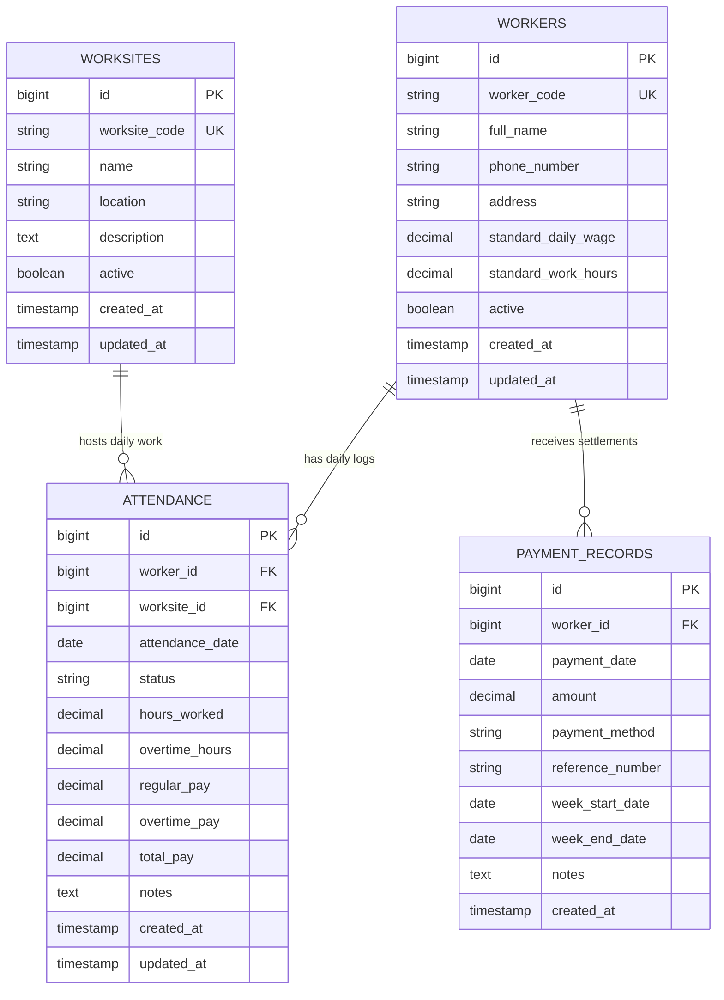

# WageTrack — Database Schema & Entity Design

WageTrack relies on a relational MySQL 8+ database schema designed with financial precision, strict transactional integrity, and proper indexing.

---

## Entity Relationship Diagram (Mermaid)

---

## Schema Highlights

1. **Financial Precision (`DECIMAL(12, 2)`):**
   - All wage, pay, and payment amounts use `DECIMAL(12, 2)` instead of floating-point types (`FLOAT`/`DOUBLE`) to eliminate rounding inaccuracies.

2. **Unique Attendance Constraint (`uq_worker_worksite_date`):**
   - Prevents duplicate attendance logging for the same worker at the same worksite on the same calendar date.

3. **Performance Indexing:**
   - `workers`: Index on `worker_code`, `active`
   - `worksites`: Index on `worksite_code`, `active`
   - `attendance`: Index on `worker_id`, `worksite_id`, `attendance_date`
   - `payment_records`: Index on `worker_id`, `payment_date`
